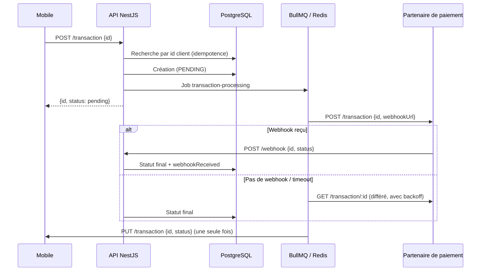

# Resilient Payment API — NestJS

API de transactions de paiement conçue pour rester **rapide et fiable côté mobile**, même lorsque le partenaire de paiement est lent, instable ou incomplet dans ses réponses.

> Projet réalisé dans le cadre d'un exercice technique fintech : intégrer un service de paiement tiers peu fiable sans dégrader l'expérience de l'utilisateur mobile.

## Le problème

Une application mobile demande un transfert d'argent à l'API, qui le transmet à un partenaire de paiement. Ce partenaire pose plusieurs difficultés :

- il répond lentement (jusqu'à 10 s) et ne donne pas toujours le résultat final tout de suite ;
- il renvoie parfois une erreur **504**, alors que la transaction peut quand même aboutir plus tard (jusqu'à 120 s) ;
- il est censé notifier le résultat par **webhook**, mais ne le fait pas toujours ;
- son API de statut existe, mais il ne faut pas l'interroger trop souvent.

Côté mobile, il faut répondre **le plus vite possible**, communiquer le résultat final **dès qu'il est connu** et ne traiter **qu'une seule fois** une requête que le mobile renverrait à cause d'un réseau instable.

## La solution

| Besoin | Réponse apportée |
|---|---|
| Réponse rapide au mobile | La transaction est enregistrée puis traitée en asynchrone. L'API répond immédiatement `pending`. |
| Requêtes en double | **Idempotence** grâce à l'identifiant fourni par le client, protégé par un index unique PostgreSQL. Une requête répétée renvoie le statut existant. |
| Partenaire lent ou en timeout | Files **BullMQ / Redis** avec retries et backoff exponentiel. Un timeout n'est pas considéré comme un échec : une vérification de statut est planifiée. |
| Webhook manquant | Une vérification de statut différée prend le relais, seulement si le webhook n'est pas arrivé. |
| Webhook et vérification qui se croisent | Les indicateurs `webhookReceived` et `clientNotified` évitent les appels inutiles et les doubles notifications. |
| Notification du client en échec | File dédiée avec retries. |

### Architecture



Trois files indépendantes, chacune avec sa propre politique de retry :

1. **`transaction-processing`** : appel au partenaire, puis planification d'une vérification de statut si le résultat n'est pas encore final.
2. **`status-check`** : interroge le partenaire uniquement si aucun webhook n'a été reçu et si la transaction n'est pas déjà finalisée.
3. **`client-notification`** : informe le mobile du résultat final, une seule fois.

### Cycle de vie d'une transaction

`PENDING` → `PROCESSING` → `COMPLETED` | `DECLINED` | `FAILED`

> Le schéma de la base de données et la gestion détaillée des cas limites sont décrits dans [`your_api/README.md`](your_api/README.md).

## Stack technique

NestJS · TypeScript · PostgreSQL · TypeORM · BullMQ · Redis · Axios · Docker Compose

## Lancer le projet

Prérequis : Docker et Docker Compose.

```bash
docker-compose up --build
```

| Service | URL |
|---|---|
| API NestJS | http://localhost:3001 |
| Mock du partenaire de paiement | http://localhost:3000 |
| Mock du client mobile | http://localhost:3100 |
| PostgreSQL | localhost:5432 |
| Redis | localhost:6379 |

Déclencher une transaction via le client simulé :

```bash
curl -X POST http://localhost:3100/transaction -H "Content-Type: application/json"
```

Suivre le cycle de vie dans les logs :

```bash
docker-compose logs -f your_api client
```

## Endpoints

| Méthode | Route | Rôle |
|---|---|---|
| `POST` | `/transaction` | Crée une transaction (`{ "id": "<uuid>" }`) ou renvoie le statut d'une transaction existante |
| `POST` | `/webhook` | Reçoit le résultat envoyé par le partenaire (`{ "id", "status" }`) |

## Structure

```
.
├── your_api/        # API NestJS (contrôleurs, services, processors BullMQ, entité Transaction)
├── thirdpartymock/  # Simulation du partenaire de paiement instable
├── client/          # Simulation de l'application mobile
└── docker-compose.yml
```

## Pistes d'amélioration

- Tests unitaires et d'intégration sur l'idempotence et les processors.
- Validation des entrées avec `class-validator`.
- Gestion explicite des requêtes concurrentes portant le même identifiant.
- Endpoint `GET /transaction/:id` pour que le mobile consulte le statut lui-même.
- Logs structurés avec identifiant de corrélation, et tableau de bord des files.
- Migrations TypeORM à la place de `synchronize` pour la production.

## Auteur

**Mariko Oudou** — Développeur Full Stack (Flutter / NestJS / paiements Mobile Money)
[LinkedIn](https://www.linkedin.com/in/mariko-oudou) · [GitHub](https://github.com/MarikoOudou)
