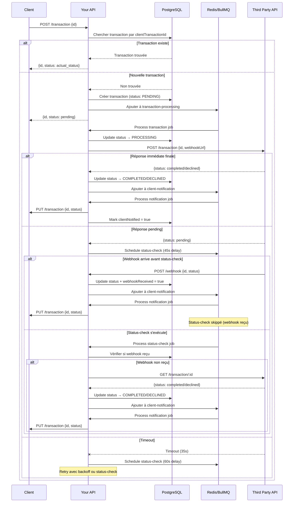

# Your API

API de traitement de transactions avec gestion asynchrone et haute résilience.

## Stack technique

Le projet utilise NestJS comme framework principal avec TypeScript pour bénéficier du typage statique et de l'architecture modulaire. La persistance des transactions est assurée par PostgreSQL, une base de données relationnelle robuste et performante. Pour la gestion des queues et le traitement asynchrone, nous utilisons Redis combiné avec BullMQ, qui offre des fonctionnalités avancées de retry et de scheduling. L'ORM TypeORM facilite l'interaction avec la base de données en fournissant une couche d'abstraction orientée objet. Enfin, Axios est utilisé comme client HTTP pour effectuer les appels vers l'API tierce et le client.

## Architecture et approche

### Vue d'ensemble

L'API implémente un système de traitement de transactions asynchrone conçu pour gérer les problèmes de fiabilité d'une API tierce (timeouts, webhooks retardés, réponses lentes).

### Principes clés

L'architecture repose sur quatre principes fondamentaux. Le premier est l'idempotence : chaque transaction utilise un ID client unique, ce qui permet aux requêtes dupliquées de retourner l'état actuel sans créer de nouvelle transaction. Le deuxième principe est le traitement asynchrone : les appels à l'API tierce sont traités via des queues BullMQ, permettant de retourner une réponse immédiate au client avec un status "pending", de gérer les retries en cas d'échec, et de paralléliser le traitement pour améliorer les performances. Le troisième principe est la résilience : plusieurs mécanismes de fallback sont mis en place, notamment un système de retry avec backoff exponentiel, des status checks périodiques en cas de timeout, et un fallback sur du polling si le webhook n'arrive pas. Enfin, le quatrième principe est la séparation des responsabilités grâce à une architecture basée sur trois queues indépendantes, chacune ayant un rôle spécifique dans le cycle de vie d'une transaction.

## Statuts de transaction

Le système utilise 5 statuts différents :

| Status | Description |
|--------|-------------|
| `PENDING` | Transaction créée, en attente de traitement |
| `PROCESSING` | Transaction en cours de traitement par l'API tierce |
| `COMPLETED` | Transaction acceptée et finalisée avec succès |
| `DECLINED` | Transaction refusée par l'API tierce |
| `FAILED` | Échec technique après épuisement des tentatives |

## Les 3 queues

### 1. Queue `transaction-processing`

Cette queue est responsable du traitement initial de la transaction. Son workflow commence par l'appel à l'API tierce avec le webhook URL. Si l'API retourne une réponse immédiate avec un statut final (completed ou declined), le système met immédiatement à jour le statut en base de données et notifie le client. Si la réponse indique que la transaction est en attente (pending), un status check est programmé automatiquement après 45 secondes pour vérifier l'évolution. En cas de timeout de l'API tierce, un status check est également programmé mais avec un délai plus long de 60 secondes pour laisser le temps au système distant de se stabiliser. La queue effectue jusqu'à 5 tentatives en cas d'erreur, avec un backoff exponentiel entre chaque retry pour éviter de surcharger l'API tierce.

### 2. Queue `status-check`

Cette queue a pour rôle de vérifier le statut d'une transaction en cas de timeout ou de webhook manquant. Son workflow est optimisé pour éviter les appels inutiles : elle skip automatiquement si le webhook a déjà été reçu ou si la transaction est déjà dans un état final. Si ces conditions ne sont pas remplies, elle appelle l'endpoint GET /transaction/:id sur l'API tierce pour obtenir le statut actuel. Une fois la réponse reçue, elle met à jour le statut en base de données et notifie le client du résultat final. Si le statut est toujours "pending", le job effectue un retry automatique. Cette queue est configurée avec un délai initial de 45 secondes après une réponse pending, ou de 60 secondes après un timeout. Elle effectue entre 3 et 5 tentatives selon le contexte, avec un backoff exponentiel variant de 5 à 10 secondes.

### 3. Queue `client-notification`

Cette queue est dédiée à la notification du client du résultat final via l'endpoint PUT /transaction. Son workflow commence par vérifier le flag `clientNotified` pour éviter d'envoyer des notifications en double. Si le client n'a pas encore été notifié, elle appelle l'endpoint PUT du client avec le résultat final de la transaction. Une fois l'appel réussi, elle marque la transaction comme notifiée en base de données. En cas d'échec de l'appel (client temporairement indisponible, erreur réseau, etc.), la queue effectue automatiquement un retry. Elle est configurée pour effectuer jusqu'à 3 tentatives avec un backoff exponentiel entre chaque essai.

## Endpoints

### POST /transaction

Cet endpoint permet de créer une nouvelle transaction ou de récupérer le statut d'une transaction existante. Le body de la requête doit contenir un champ `id` contenant un UUID v4 généré par le client. La réponse varie selon que la transaction existe déjà ou non : pour une nouvelle transaction, l'API retourne `{ "id": "uuid", "status": "pending" }`, tandis que pour une transaction existante, elle retourne `{ "id": "uuid", "status": "<statut_actuel>" }`.

Le comportement de cet endpoint suit une logique précise : il vérifie d'abord si la transaction existe déjà en recherchant par `clientTransactionId` dans la base de données. Si la transaction existe, il retourne simplement le statut actuel sans aucun traitement supplémentaire, garantissant ainsi l'idempotence. Si la transaction n'existe pas, il la crée en base avec un statut PENDING, l'ajoute immédiatement à la queue `transaction-processing` pour un traitement asynchrone, et retourne la réponse "pending" au client sans attendre le résultat du traitement. Cette approche permet de garantir un temps de réponse très rapide au client, quelle que soit la latence de l'API tierce.

### POST /webhook

Cet endpoint est destiné à recevoir les webhooks de l'API tierce. Le body de la requête contient un champ `id` avec l'identifiant de la transaction et un champ `status` pouvant prendre les valeurs "completed", "declined" ou "pending".

Le comportement de l'endpoint est le suivant : il recherche d'abord la transaction en base de données par son `clientTransactionId`. Si la transaction existe, il met à jour son statut avec la valeur reçue et marque le flag `webhookReceived` à true pour indiquer que le webhook a bien été reçu. Si le statut reçu est final (completed ou declined), il ajoute automatiquement un job à la queue `client-notification` pour informer le client du résultat. Ce mécanisme permet de traiter les webhooks de manière fiable tout en évitant les doublons avec le système de status-check.

## Schéma de flux



## Base de données

### Table `transactions`

| Colonne | Type | Description |
|---------|------|-------------|
| `id` | UUID | Clé primaire interne |
| `clientTransactionId` | VARCHAR | ID fourni par le client (unique, indexé) |
| `status` | ENUM | Statut de la transaction |
| `thirdPartyStatus` | VARCHAR | Statut brut de l'API tierce |
| `createdAt` | TIMESTAMP | Date de création |
| `updatedAt` | TIMESTAMP | Dernière mise à jour |
| `lastAttemptAt` | TIMESTAMP | Dernière tentative d'appel |
| `attemptCount` | INTEGER | Nombre de tentatives |
| `webhookReceived` | BOOLEAN | Webhook reçu de l'API tierce |
| `clientNotified` | BOOLEAN | Client notifié du résultat |

La table dispose de trois index pour optimiser les performances : une clé primaire sur le champ `id`, un index unique sur `clientTransactionId` pour garantir l'unicité et accélérer les recherches d'idempotence, et un index sur `status` pour faciliter les requêtes de filtrage par statut.

## Gestion des cas limites

### 1. Timeout de l'API tierce

Le premier cas limite concerne les timeouts : l'API tierce peut mettre plus de 30 secondes à répondre, ce qui dépasse généralement les timeouts HTTP standards. Pour gérer cette situation, nous avons configuré un timeout de 35 secondes pour laisser une marge suffisante. En cas de timeout, le système ne considère pas immédiatement la transaction comme échouée, mais programme un status-check après 60 secondes pour laisser le temps à l'API tierce de traiter la demande. Le système effectue jusqu'à 5 tentatives de status-check avec un backoff exponentiel entre chaque tentative, ce qui permet de gérer les cas où l'API tierce connaît des ralentissements temporaires.

### 2. Webhook jamais reçu

Le deuxième cas limite est celui où le webhook ne parvient jamais à notre système. Cela peut arriver pour diverses raisons : problème réseau, firewall bloquant, erreur côté API tierce, etc. Pour pallier ce problème, un status-check automatique est programmé après 45 secondes dès que l'API tierce retourne un statut "pending". Avant d'interroger l'API tierce, le status-check vérifie toujours le flag `webhookReceived` pour éviter des appels inutiles si le webhook est finalement arrivé. Le système continue de poller l'API tierce jusqu'à obtenir un statut final, garantissant qu'aucune transaction ne reste bloquée indéfiniment dans un état pending.

### 3. Webhook reçu après status-check

Un troisième cas limite se produit lorsque le webhook arrive après que le système ait déjà effectué un status-check avec succès. Dans ce scénario, les deux mécanismes (webhook et status-check) tentent de mettre à jour la même transaction. La solution repose sur une conception qui permet aux deux mécanismes de coexister sans conflit : ils mettent tous deux à jour la même transaction en base de données de manière idempotente. Le flag `webhookReceived` permet aux futurs status-checks d'éviter des appels inutiles, et le flag `clientNotified` garantit que le client n'est notifié qu'une seule fois, même si les deux mécanismes aboutissent.

### 4. Requêtes dupliquées du client

Le quatrième cas limite concerne les requêtes dupliquées : le client peut réessayer et envoyer le même ID plusieurs fois, que ce soit volontairement (retry après timeout) ou involontairement (double-clic, problème réseau). La solution mise en place repose sur une vérification d'idempotence via le `clientTransactionId` unique : lors de chaque requête, le système vérifie si une transaction avec cet ID existe déjà. Si c'est le cas, il retourne simplement le statut actuel au lieu de créer une nouvelle transaction, garantissant qu'aucun side-effect n'est produit par les requêtes dupliquées.

### 5. Échec de notification du client

Le cinquième cas limite concerne l'échec de notification du client. Le client peut être temporairement indisponible lors de la tentative de notification, ou rencontrer des problèmes réseau. Pour gérer cette situation, une queue dédiée avec retry automatique (jusqu'à 3 tentatives) est utilisée. Le flag `clientNotified` évite d'envoyer des notifications dupliquées si plusieurs tentatives aboutissent. De plus, le client peut toujours interroger notre API directement pour connaître le statut d'une transaction, offrant ainsi un mécanisme de fallback si les notifications push échouent définitivement.

## Lancement du projet

### Prérequis

Avant de lancer le projet, assurez-vous d'avoir Docker et Docker Compose installés sur votre machine. Le projet utilise Docker pour orchestrer l'ensemble de la stack (PostgreSQL, Redis, les API et le client), ce qui garantit un environnement de développement identique pour tous les développeurs et simplifie grandement le déploiement.

### Démarrage initial

Pour démarrer l'ensemble de la stack pour la première fois, positionnez-vous à la racine du projet (là où se trouve le fichier `docker-compose.yml`) et exécutez la commande suivante :

```bash
docker-compose up --build
```

L'option `--build` force la reconstruction des images Docker. C'est utile lors du premier démarrage ou après des modifications du Dockerfile ou des dépendances. Docker Compose va alors :

1. Télécharger les images de base nécessaires (PostgreSQL 15 Alpine, Redis 7 Alpine, Node 20 Alpine)
2. Construire les images personnalisées pour l'API tierce (thirdpartymock), votre API (your_api) et le client (client)
3. Créer les volumes nommés pour la persistance des données PostgreSQL et Redis
4. Démarrer les conteneurs dans l'ordre défini par les dépendances (postgres et redis en premier, puis thirdparty, puis your_api, et enfin client)
5. Attendre que les services soient prêts grâce aux healthchecks configurés

Le processus de démarrage prend généralement entre 1 et 3 minutes selon votre connexion internet et les performances de votre machine. Vous verrez défiler les logs de compilation de TypeScript et de démarrage des différents services. Lorsque vous voyez le message "Nest application successfully started", cela signifie que votre API est prête à recevoir des requêtes.

### Démarrage en mode détaché

Pour les utilisations suivantes, vous pouvez démarrer la stack en arrière-plan avec l'option `-d` (detached mode) :

```bash
docker-compose up -d
```

Cette commande démarre tous les services en arrière-plan et vous rend immédiatement la main dans le terminal. Vous pouvez ensuite consulter les logs avec les commandes décrites dans la section suivante.

### Vérification que les services sont actifs

Pour vérifier que tous les conteneurs sont bien démarrés, utilisez :

```bash
docker-compose ps
```

Cette commande affiche l'état de tous les services. Vous devriez voir 5 services avec le statut "Up" : postgres, redis, thirdparty, your_api et client. Les ports exposés sont également affichés dans cette vue.

### Arrêt de la stack

Pour arrêter proprement tous les services :

```bash
docker-compose down
```

Cette commande arrête et supprime tous les conteneurs, mais préserve les volumes de données (PostgreSQL et Redis). Si vous souhaitez également supprimer les volumes et repartir sur une base de données vierge :

```bash
docker-compose down -v
```

### Ports exposés

Une fois la stack démarrée, les services sont accessibles sur les ports suivants :

- PostgreSQL : `localhost:5432` (credentials: djamo/djamo_dev, database: transactions)
- Redis : `localhost:6379` (pas d'authentification en dev)
- Third Party Mock : `localhost:3000` (API tierce simulée)
- Your API : `localhost:3001` (votre API NestJS)
- Client Mock : `localhost:3100` (client simulé)

Notez que votre API est exposée sur le port 3001 et non 3000, car elle écoute en interne sur le port 3000 qui est mappé vers 3001 en externe.

### Mode développement avec hot reload

Le projet est configuré pour le développement avec hot reload activé. Les répertoires `your_api/src` et `your_api/test` sont montés comme volumes dans le conteneur, ce qui signifie que toute modification de fichier dans ces répertoires déclenche automatiquement une recompilation de NestJS. Vous pouvez voir la recompilation dans les logs avec la commande :

```bash
docker logs -f interview-swe-01-your_api-1
```

Lorsque vous modifiez un fichier, vous verrez des messages indiquant "File change detected. Starting incremental compilation..." suivi de "Found 0 errors. Watching for file changes." Les modifications sont généralement prises en compte en quelques secondes.

### Variables d'environnement

Toutes les variables d'environnement nécessaires sont déjà configurées dans le fichier `docker-compose.yml`. Voici les principales :

- `REDIS_HOST` et `REDIS_PORT` : configuration de la connexion à Redis pour BullMQ
- `THIRDPARTY_URL` : URL de l'API tierce (http://thirdparty:3000 dans le réseau Docker)
- `CLIENT_URL` : URL du client pour les notifications (http://client:3100)
- `YOUR_API_URL` : URL de votre API utilisée dans les webhooks (http://your_api:3000)
- `DB_HOST`, `DB_PORT`, `DB_USERNAME`, `DB_PASSWORD`, `DB_DATABASE` : configuration PostgreSQL

Ces variables utilisent les noms de services Docker comme hostnames (postgres, redis, thirdparty, etc.), ce qui fonctionne automatiquement grâce au réseau Docker interne.

### Initialisation de la base de données

La base de données PostgreSQL est automatiquement initialisée au premier démarrage. TypeORM est configuré avec l'option `synchronize: true`, ce qui signifie que le schéma de la table `transactions` est créé automatiquement au démarrage de l'application NestJS. Aucune migration manuelle n'est nécessaire en environnement de développement.

⚠️ **Note importante** : L'option `synchronize: true` ne doit jamais être utilisée en production car elle peut entraîner des pertes de données. En production, il faut utiliser un système de migrations TypeORM.

## Tests

### Test manuel simple

Pour tester rapidement que l'API fonctionne, vous pouvez envoyer une requête POST au client mock qui va lui-même appeler votre API :

```bash
curl -X POST http://localhost:3100/transaction -H "Content-Type: application/json"
```

Le client génère automatiquement un UUID v4 et l'envoie à votre API. Vous devriez voir dans les logs du client le message "Transaction {id} is pending", suivi quelques secondes plus tard de "Transaction {id} marked as accepted" ou "declined" selon le comportement de l'API tierce mockée.

### Test de charge

Un script bash est fourni pour effectuer un test de charge de 1000 requêtes. Pour l'exécuter :

```bash
./test-load.sh
```

Le script affiche la progression toutes les 100 requêtes et fournit un résumé à la fin avec le nombre de requêtes réussies et échouées. C'est utile pour vérifier que le système gère correctement la charge et que les mécanismes de queue fonctionnent bien.

### Suivi des logs en temps réel

Pour suivre les logs de tous les services simultanément :

```bash
docker-compose logs -f
```

Pour suivre uniquement les logs d'un service spécifique :

```bash
docker logs -f interview-swe-01-your_api-1
```

Vous pouvez également limiter le nombre de lignes affichées initialement :

```bash
docker logs -f --tail 100 interview-swe-01-your_api-1
```

Les logs permettent de voir en temps réel le cycle de vie des transactions : création, ajout à la queue, traitement, appel à l'API tierce, réception du webhook, notification du client, etc.

### Accès à la base de données

Si vous souhaitez inspecter directement la base de données PostgreSQL, vous pouvez vous connecter avec :

```bash
docker exec -it interview-swe-01-postgres-1 psql -U djamo -d transactions
```

Une fois connecté, vous pouvez exécuter des requêtes SQL pour inspecter les transactions :

```sql
SELECT * FROM transactions ORDER BY "createdAt" DESC LIMIT 10;
```

### Monitoring des queues Redis

Pour voir l'état des queues Redis et les jobs en cours, vous pouvez vous connecter au conteneur Redis :

```bash
docker exec -it interview-swe-01-redis-1 redis-cli
```

Ensuite, utilisez les commandes Redis pour inspecter les clés :

```
KEYS bull:*
```

Cela affiche toutes les clés créées par BullMQ pour gérer les trois queues.

## Améliorations possibles

### Court terme

À court terme, il serait bénéfique d'ajouter des tests unitaires et d'intégration pour valider le comportement de chaque composant et garantir la non-régression lors des évolutions futures. Un système de logging structuré avec corrélation ID permettrait de suivre facilement une transaction à travers tous les logs des différents composants, facilitant grandement le debugging et le monitoring en production.

### Moyen terme

À moyen terme, l'ajout d'un endpoint GET /transaction/:id permettrait au client d'interroger directement le statut d'une transaction, offrant ainsi une alternative au système de notification push. Un dashboard pour visualiser l'état des queues en temps réel serait très utile pour le monitoring opérationnel, permettant de voir le nombre de jobs en attente, en cours de traitement, ou en échec. Enfin, un système de rate limiting protégerait l'API contre les abus et les surcharges accidentelles.

### Long terme

À long terme, pour supporter une montée en charge importante, il faudrait envisager la scalabilité horizontale en déployant plusieurs workers pour traiter les queues en parallèle. Un système d'event sourcing pourrait être mis en place pour conserver un historique complet de tous les événements liés à chaque transaction, facilitant l'audit et le debugging. Les notifications en temps réel via WebSocket au lieu de PUT callback offriraient une meilleure expérience utilisateur en permettant au client de recevoir les mises à jour instantanément. Enfin, un système de priorité dans les queues permettrait de traiter en priorité certaines transactions critiques.
